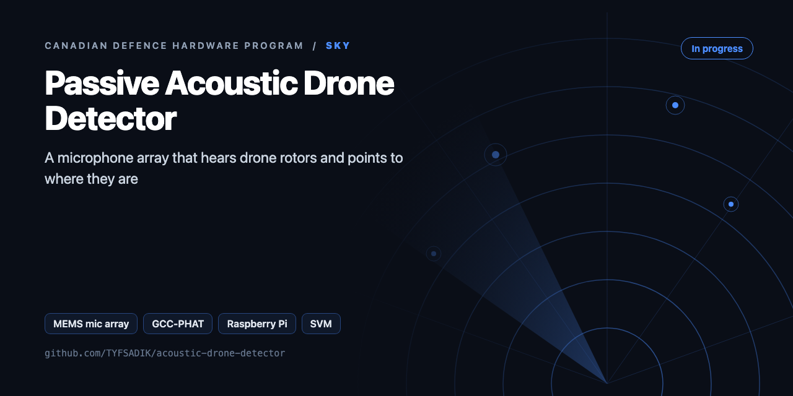
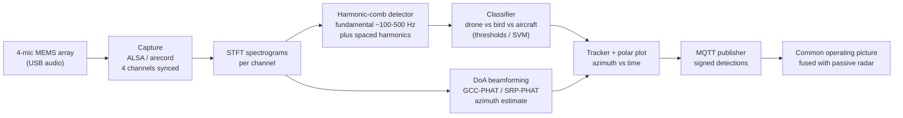

<div align="center">



# Passive Acoustic Drone Detector

**MEMS microphone array on a Raspberry Pi that detects drone rotor harmonics, rejects birds and aircraft, and estimates direction of arrival by beamforming.**

[](https://github.com/TYFSADIK/acoustic-drone-detector/actions/workflows/tests.yml)   [](LICENSE) [](https://github.com/TYFSADIK/defence-hardware-program)

[Build guide](docs/project-page.md) · [How it works](#how-it-works) · [Quick start](#quick-start) · [Program hub](https://github.com/TYFSADIK/defence-hardware-program)

</div>

## Overview

**NRC and DRDC have built a counter-drone detection system** that picks up the signature of a drone's rotating propellers without emitting any radio signal that could reveal its own location. This build is that idea at hobby scale: a ReSpeaker-class 4-mic USB array on a Raspberry Pi 5 that does nothing but listen. The microphone front end emits no RF, so the sensing itself reveals no radio signature; reporting detections over the network still transmits, so the node is RF-quiet, not RF-invisible, and a powered Pi can be found by other means.

Small multirotor drones announce themselves acoustically whether they want to or not. Each rotor spins at a fixed rate per flight phase, producing a **fundamental blade-pass frequency in the ~100-500 Hz band plus a comb of evenly spaced harmonics** that persists as long as the motors run. Birds flap (intermittent, broadband), fixed-wing aircraft drone on much lower frequencies at much greater distance, and traffic noise is broadband and unstructured. That harmonic comb is a fingerprint, and it is what this sensor keys on.

The context is the same one driving the whole program: Canada's **Defence Drone Initiative** (launched July 23, 2026) and the Army MINERVA challenges both assume small drones are cheap, common, and hard to see. A receive-only acoustic node is the cheapest possible layer of counter-drone awareness, it costs about as much as a dinner out, runs off a USB power bank, and feeds its detections into the same common operating picture as my passive radar node.

## How it works



*Capture, spectrogram, harmonic-comb detection, classification, beamforming, and reporting. Everything runs on the Pi; only signed detections leave the node.*

## Quick start

```bash
python3 -m venv .venv && source .venv/bin/activate
pip install -r requirements.txt
python demo.py
python -m unittest -v
```

Real output from the demo, run on simulated data:

```text
drone: drone=True f0=181Hz comb=0.98 harmonics=8
bird : drone=False f0=259Hz comb=0.04 harmonics=0
bearing: true=125 deg  estimated=129 deg  (tdoa rms err 37.7 us)
```

## What's in this repo

| File | Purpose |
|---|---|
| `acoustic/array.py` | Mic geometry (**replace with your measured positions**), temperature-corrected speed of sound |
| `acoustic/harmonics.py` | Harmonic comb detector: finds the blade-pass f0 and scores how much energy sits on its harmonics |
| `acoustic/gcc_phat.py` | GCC-PHAT delay estimation and azimuth grid search |
| `acoustic/simulate.py` | Synthetic rotor, bird chirp, and multi-mic capture, so you can develop without flying |
| `demo.py` | End-to-end demo on simulated data |

## What you need

| Category | Item | Notes |
|----|----|----|
| Hardware | 4-mic USB array | ReSpeaker-class, 16 kHz documented maximum; resolve it by name, never by card index |
| Hardware | Raspberry Pi 5 + USB power bank | Streaming capture, STFT, and the SVM all run on the node |
| Hardware | Foam windscreen, IP65 enclosure | Wind rejection at the mic; the enclosure is the T5 field-kit item |
| Software | ALSA, Python numpy/scipy | Capture and the STFT + GCC-PHAT pipeline |
| Software | scikit-learn | SVM classifier with balanced class weights, trained on labelled sessions |
| Software | systemd, mosquitto | Service supervision with NTP wait, signed MQTT detection events |
| Skills | DSP basics, Linux audio | Reading spectrograms, understanding beamforming geometry, real-time capture discipline |
| Accounts | None | No accounts or licenses required for a passive microphone array |

## Status

- **Done**: array running its documented 16 kHz firmware; per-channel capture verified with arecord and the tap-test map; channel sync confirmed by cross-correlation; streaming capture loop with overflow handling; STFT + adaptive noise floor + harmonic-comb detector running on the Pi; GCC-PHAT/SRP-PHAT polar-plot tracker tracking my own drones on the bench; systemd service with restart and NTP wait; signed MQTT event schema defined.
- **In progress**: classifier training set (own drones + negative sources, split by session); SVM tuning against the threshold baseline; T1 bench azimuth calibration series; negative-source false-alarm sessions (T4).
- **Next**: outdoor T2/T3 run series for detection envelope and tracking accuracy; long-soak runs (T5); IP65 enclosure and power-bank field kit; signed MQTT feed into the common operating picture and the T6 fusion dry run with the passive radar node.

| Metric | Target | Current status |
|----|----|----|
| Bench DoA error (T1) | Sector-level agreement with known bearings, accurate enough to cue a camera or second sensor | In progress, calibration rig works, full 8-position series not yet logged |
| Detection envelope (T2) | A clear, repeatable detection range against my own quads in quiet conditions | In progress, bench detection confirmed, outdoor run series not yet done |
| Track continuity (T3) | A continuous track through a fly-past, with DoA error bounded against the drone's GPS flight log as a reference | In progress, tracker locks on the bench; fly-past series not yet done |
| False-alarm rate (T4) | Low enough that a human reviewing the alert queue is not numbed by noise; measured per source, not assumed | In progress, lawnmower and traffic sessions collected, more sources pending |
| Long-soak stability (T5) | Multi-day unattended uptime with no manual intervention | In progress, service hardening done, soak runs not yet logged |
| Fusion latency (T6) | Acoustic and RF tracks fused into one track in the common operating picture | Next, waiting on the passive radar node's reporting feed |

## Roadmap

- [ ] Capture 4-channel audio on the Pi (`arecord -D ac108 -c 4 -r 16000 -f S16_LE`) and feed it to `estimate_azimuth`
- [ ] Put the tap-test channel map and measured mic positions into `array.py`
- [ ] Log every detection with a timestamp and compare it with flight-log ground truth (bearing error, Pd, false alarms per hour)
- [ ] Add an aircraft rejector (low f0 and slowly drifting spectrum) and record a bird/wind negative set
- [ ] Use `speed_of_sound(temp_c)` from a temperature sensor during winter runs

## Related builds

- [**Canadian Defence Hardware Program**](https://github.com/TYFSADIK/defence-hardware-program), the program hub; this node is part of the counter-drone layer.
- [**Sky: Passive Aerial Early-Warning Node**](https://github.com/TYFSADIK/sky-passive-radar-node), the other receive-only air sensor; its RF tracks fuse with this node's acoustic tracks.
- [**Counter-Drone Sensor Fusion Simulator**](https://github.com/TYFSADIK/counter-drone-sensor-fusion), the simulation sibling where acoustic + passive-radar fusion logic gets exercised.
- [**Multi-Domain Common Operating Picture**](https://github.com/TYFSADIK/multi-domain-common-operating-picture), where this node's signed MQTT detections end up.

## Safety and legal

**Privacy by design:** the pipeline keys on narrow-band rotor harmonics and discards everything else. It is not a microphone for speech and records no conversations: audio windows are processed in memory and thrown away; only detection events (azimuth, frequency, timestamp, confidence) are stored.

**Detection only:** this node senses and reports. No jamming, no spoofing, both are illegal in Canada. The whole point of the receive-only sensing design is that the microphones never transmit anything at all; only the MQTT reporting uplink uses the network.

## Learn more

The full build guide, with step-by-step instructions, wiring, troubleshooting and lessons learned, is in [docs/project-page.md](docs/project-page.md). It is also published at [tyfsadik.org](https://tyfsadik.org/work/defence/acoustic-drone-detector.html).

## License

[MIT](LICENSE). Built by [Taki Sadik](https://tyfsadik.org) as part of the self-funded [Canadian Defence Hardware Program](https://github.com/TYFSADIK/defence-hardware-program).
