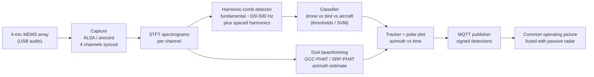
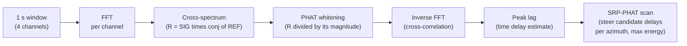

# Passive Acoustic Drone Detector

Written by [Taki Sadik](https://tyfsadik.org/about.html) · Last updated 2026-10-22 · Status: Building · 28 min read

A MEMS microphone array on a Raspberry Pi that listens for the harmonic comb of drone rotors, rejects birds and aircraft, and estimates direction of arrival by beamforming. The sensing front end emits nothing at all; only network reporting leaves the box.

## Overview

**NRC and DRDC have built a counter-drone detection system** that picks up the signature of a drone's rotating propellers without emitting any radio signal that could reveal its own location. This build is that idea at hobby scale: a ReSpeaker-class 4-mic USB array on a Raspberry Pi 5 that does nothing but listen. The microphone front end emits no RF, so the sensing itself reveals no radio signature; reporting detections over the network still transmits, so the node is RF-quiet, not RF-invisible, and a powered Pi can be found by other means.

Small multirotor drones announce themselves acoustically whether they want to or not. Each rotor spins at a fixed rate per flight phase, producing a **fundamental blade-pass frequency in the ~100-500 Hz band plus a comb of evenly spaced harmonics** that persists as long as the motors run. Birds flap (intermittent, broadband), fixed-wing aircraft drone on much lower frequencies at much greater distance, and traffic noise is broadband and unstructured. That harmonic comb is a fingerprint, and it is what this sensor keys on.

The context is the same one driving the whole program: Canada's **Defence Drone Initiative** (launched July 23, 2026) and the Army MINERVA challenges both assume small drones are cheap, common, and hard to see. A receive-only acoustic node is the cheapest possible layer of counter-drone awareness, it costs about as much as a dinner out, runs off a USB power bank, and feeds its detections into the same common operating picture as my passive radar node.

## Bill of Materials

| Item | What I used | Est. US\$ |
|----|----|----|
| Microphone array | ReSpeaker-class 4-mic USB array | 70-100 |
| Compute | Raspberry Pi (Pi 5 4 GB from program stock) | ~85 |
| Enclosure | IP65 box, cable glands, mounting hardware | 20-40 |
| Storage | High-endurance microSD / NVMe HAT (shared workshop stock) | \- |
| Power | Official 27 W Pi 5 supply or USB-C PD power bank | 25-55 |

Everything is already on the bench. Total build cost lands around US\$200-280 depending on the power option, the Pi, storage, and power gear come from the shared Phase 0 workshop stock bought for the whole program.

## Wiring & Connections

There is deliberately little to wire, no SDR front end, no antennas, no RF anything. The whole node is the array, the Pi, and power; everything else is network.

| From | To | Cable or interface | Notes |
|----|----|----|----|
| 4-mic MEMS array | Pi 5 USB-A port | USB-C to USB-A cable (direct) | Enumerates as a USB Audio Class device; plug directly into the Pi, never through an unpowered hub, brownouts corrupt audio streams silently |
| Pi 5 | Official 27 W supply / PD power bank | USB-C PD | Must negotiate the 5 V / 5 A profile; check for undervoltage with `vcgencmd get_throttled` |
| Pi 5 | Bench laptop | Ethernet (gigabit) | SSH for development, `scp` for pulling test recordings, polar-plot dashboard over LAN |
| Pi 5 | MQTT broker (homelab) | Wi-Fi or Ethernet LAN | Detections only; node buffers to local disk when the link drops and forwards on reconnect |
| Mic array | Bench stand / enclosure lid | 1/4" thread + standoffs | Mounted clear of the bench so reflections off the tabletop do not smear the DoA solution |
| Pi 5 | Laptop acoustic view | SSH + X-forwarded matplotlib / web dashboard | The four-channel scope-style view on the bench is rendered from the captured USB stream, not from probe leads, there is nothing analog to probe |

## Architecture

Figure 1: capture, spectrogram, harmonic-comb detection, classification, beamforming, and reporting. Everything runs on the Pi; only signed detections leave the node.

The two analysis branches share one spectrogram stage. Detection and classification work on the summed audio (best signal-to-noise), while direction of arrival works on the phase differences *between* channels. Raw audio is processed in memory in short windows and discarded, only detection events with azimuth, timestamp, and confidence are kept.

## Why PHAT Weighting Works on Rotor Combs

GCC-PHAT (generalized cross-correlation with phase transform) is doing something clever that maps directly onto how a drone sounds. A rotor comb is a set of narrowband peaks: one or two harmonics are usually much louder than the rest. If you cross-correlate two mic channels directly, those loud peaks dominate the correlation, and the delay estimate locks onto the loudest tone instead of the wavefront as a whole, including its echoes off the ground and nearby objects.

**Figure 2:** the GCC-PHAT delay pipeline. PHAT whitening is the key step: after dividing by the magnitude, every frequency bin contributes equally to the correlation, so the broadband wavefront wins over the loudest single harmonic.

### The whitening intuition

Think of each frequency bin as a voter on the question "which channel heard it first". Without whitening, the loud bins get a thousand votes each and the quiet bins get one: the election is decided by whoever is shouting. PHAT divides the cross-spectrum by its own magnitude, which gives every bin exactly one vote. Now the verdict comes from the one thing all the frequencies share, the geometry of the wavefront crossing the array, instead of from the accidental loudness of one harmonic. That is why the bench track on the bench locks onto the comb containing a strong spectral line near 660 Hz as a *direction* rather than locking onto that line as a *tone*.

SRP-PHAT (steered-response power with phase transform) extends the same idea to bearing. For each candidate azimuth, I compute what time delay each mic *should* see from that direction (given the measured array geometry below), steer the channels by those delays, and combine them with steered delay-and-sum into a steered power estimate. The azimuth whose delays line up best wins. The allowed correlation lag range is derived from the measured mic spacing: the maximum physically possible delay is the mic spacing divided by the speed of sound, and step 08 restricts the GCC-PHAT search to that window before picking a peak, because a lag outside it would be a bug, not a bearing.

## Array Geometry

The whole bearing estimate rests on four mics in a *measured* geometry. Microphone positions and channel mapping on this installed board were measured directly (tape measure on the board plus the tap-test map from step 02); published figures for one ReSpeaker variant do not transfer to another, and no geometry from a datasheet is used unmeasured here. The tap-test map from step 02 is the ground truth for which channel is which; the datasheet is only the starting guess.

**Spatial aliasing note:** spatial aliasing begins when the mic spacing approaches half a wavelength, f_alias = c / (2d) for spacing d and sound speed c, so the aliasing frequency must be computed from the *measured* mic spacing, not quoted as a fixed number. The rotor band of interest (roughly 100-2000 Hz) mostly stays below that for this class of board, which is one reason the comb harmonics above a couple of kHz help detection but are treated cautiously in the bearing estimate.

## How I Built It

### Step 01: Array bring-up

The ReSpeaker-class 4-mic USB array enumerates on the Pi 5 as a standard USB Audio Class device, no vendor drivers needed, which is exactly why I picked this class of hardware. The chain runs at the documented 16 kHz maximum sample rate of the ReSpeaker Mic Array v2.0 (XMOS XVF-3000); no vendor 48 kHz raw four-channel firmware was found for this board, so 16 kHz is the honest operating point, giving an 8 kHz Nyquist that covers the rotor comb band. Some firmware variants expose 6 channels (4 mics + 2 playback loopback), I capture 4 and ignore the loopback pair.

**Enumerate and capture all four channels**

    $ arecord -l
    **** List of CAPTURE Hardware Devices ****
    card 1: ArrayUAC10 [ReSpeaker 4 Mic Array (UAC1.0)], device 0: USB Audio [USB Audio]
      Subdevices: 1/1
      Subdevice #0: subdevice #0
    $ arecord -D hw:1,0 -f S32_LE -r 16000 -c 4 -d 10 capture_test.wav
    Recording WAVE 'capture_test.wav' : Signed 32 bit Little Endian, Rate 16000 Hz, Channels 4

**What can go wrong:** the card index is not stable across reboots: `hw:1,0` can become `hw:2,0` if something else grabs card 1. I verify by listing `/dev/snd/by-id/` and referencing the device by name in the detector config instead of by number.

### Step 02: Per-channel verification

Before any DSP, I need to know all four mics are alive, unswapped, and at sane levels. A dead or swapped channel does not break capture, it silently poisons beamforming later, which is much worse. I inspect the test WAV channel by channel in Python with `scipy.io.wavfile`, tapping each mic while recording so the channel map is proven, not assumed.

**Channel health check (python)**

    import numpy as np
    from scipy.io import wavfile

    sr, data = wavfile.read("capture_test.wav")
    print(sr, data.shape)            # expect 16000 (160000, 4)
    for ch in range(data.shape[1]):
        x = data[:, ch].astype(np.float64)
        rms = np.sqrt(np.mean(x**2))
        print(f"ch{ch}: rms={rms:12.1f}  peak={np.abs(x).max():12.0f}")

**How I verified:** each channel shows a clear RMS spike at the moment I tapped its mic, and no channel sits at digital zero. The tap map gets written into the config as the channel-to-geometry assignment, step 08 depends on it.

### Step 03: Channel sync check

Beamforming is the reason this array exists, and it only works if all four mics sample from the same clock. On this class of array they do, one shared ADC stream, but I verify it empirically anyway, because a firmware quirk here would invalidate every azimuth the node ever reports. The test: play a tone from a speaker at a known position, record all channels, and cross-correlate each against channel 0.

**Inter-channel delay check (python)**

    import numpy as np
    from scipy.signal import correlate

    x = data[:, :4].astype(np.float64)   # tone recorded on all 4 channels
    ref = x[:, 0]
    for ch in range(1, 4):
        c = correlate(x[:, ch], ref, mode="full")
        lag = np.argmax(np.abs(c)) - (len(ref) - 1)
        print(f"ch{ch} vs ch0: {lag:+d} samples = {lag / 16.0:+.3f} ms")

**How I verified:** the lags come out small, stable across repeats, and consistent with the array geometry, a circular array tens of millimetres across can only produce delays of a few samples at 16 kHz. A lag that jumps around between recordings would mean resampling or clock drift, and the array would go back.

### Step 04: Real-time capture loop

Bench WAV files prove the hardware; the field node needs a stream. I use `sounddevice` (PortAudio) with a callback that does the absolute minimum: copy the block into a queue, and a worker thread that consumes blocks, assembles ~1-second analysis windows, and runs the DSP. This split matters: if the classifier ever runs inside the audio callback, a slow frame stalls the stream and ALSA starts dropping audio.

**Streaming capture (python, sounddevice)**

    import queue
    import sounddevice as sd

    q = queue.Queue()

    def callback(indata, frames, time, status):
        if status:
            print(status)          # input overflows surface here - never ignore
        q.put(indata.copy())       # hand off; DSP happens in the worker thread

    stream = sd.InputStream(device="ReSpeaker", channels=4, samplerate=16000,
                            blocksize=4096, dtype="float32", callback=callback)
    stream.start()

**What can go wrong:** `input overflow` status lines mean the worker fell behind and audio was lost mid-window. I treat any overflow as a measurement-destroying event: the run is marked invalid rather than silently analysed with gaps.

### Step 05: Spectrogram and adaptive noise floor

Detection lives in the frequency domain. Each analysis window gets a Hann-windowed STFT (`scipy.signal.stft`, 4096-point FFT for ~3.9 Hz bins at 16 kHz) and the magnitude goes to dB. The critical extra is a *per-bin noise floor* tracked with a slow rolling median: quiet-room thresholds are useless outdoors, where wind and distant traffic raise the low-frequency floor by tens of dB. Every later stage works on signal-above-floor, not absolute level.

**Stft + noise floor (python)**

    from scipy.signal import stft

    f, t, Z = stft(window_mono, fs=16000, window="hann",
                   nperseg=4096, noverlap=3072)
    S = 20 * np.log10(np.abs(Z) + 1e-9)      # magnitude spectrogram, dB
    band = (f >= 50) & (f <= 2000)           # rotor band of interest
    floor = np.median(S_history[band], axis=1)   # slow per-bin rolling median
    Sn = S[band] - floor[:, None]            # signal-above-floor, dB

**How I verified:** with a recorded drone fly-past, the comb stands out of `Sn` clearly even in sections where wind has raised the raw floor, while on raw dB the same harmonics are buried. I keep a debug plot of floor vs. signal for every test run.

### Step 06: Harmonic-comb detector

Rotor detection looks for the comb: a candidate fundamental in the ~100-500 Hz band, then evenly spaced peaks at 2x, 3x, 4x... that *persist* across consecutive windows. Persistence is the discriminator, a single-frame peak is not enough, and rotors hold their speed for seconds while birdsong chirps come and go in tens of milliseconds. Peaks come from `scipy.signal.find_peaks` with a height set relative to the noise floor and a minimum spacing so one wide peak cannot count as two harmonics. The ~100-500 Hz candidate band, the 9 dB threshold, and the persistence settings are engineering choices tuned on my own drones, not universal drone signatures.

**Comb scoring (python)**

    from scipy.signal import find_peaks

    peaks, props = find_peaks(Sn_mean, height=9, distance=4)  # 9 dB above floor

    def comb_score(f0_bin, peaks, max_harmonic=8, tol=1):
        """Count how many multiples of f0 have a peak within +/- tol bins."""
        hits = 0
        for k in range(2, max_harmonic + 1):
            if np.any(np.abs(peaks - k * f0_bin) <= tol):
                hits += 1
        return hits

    # candidates: peaks whose bin lands in the ~100-500 Hz fundamental band
    candidates = [b for b in peaks if 26 <= b <= 128]   # 3.9 Hz/bin at 16 kHz
    best = max(candidates, key=lambda b: comb_score(b, peaks))

**What can go wrong:** a 50/60 Hz mains hum and its harmonics form a beautiful comb too. Mains sits below the drone band and its spacing is fixed, so it is excluded by the candidate range, but I logged it as a deliberate negative case during bench testing rather than trusting the math.

### Step 07: Classifier: drone vs bird vs aircraft

Comb detections become feature vectors: fundamental frequency, number of visible harmonics, comb persistence time, harmonic-to-noise ratio, and occupied bandwidth. Birds fail on persistence and spacing; distant fixed-wing aircraft sit below the drone band and fail on fundamental range; helicopters are a genuinely hard case and get their own label for now. I started with hand-set thresholds to establish a baseline, then trained a small SVM (`scikit-learn`) on recordings of my own drones plus negative samples, park ambience, traffic, birds, and a lawnmower, the classic false friend.

**Svm training (python, scikit-learn)**

    from sklearn.svm import SVC
    from sklearn.pipeline import make_pipeline
    from sklearn.preprocessing import StandardScaler
    from sklearn.model_selection import cross_val_score

    clf = make_pipeline(StandardScaler(),
                        SVC(kernel="rbf", class_weight="balanced"))
    scores = cross_val_score(clf, X, y, cv=5, scoring="f1_macro")
    print("CV f1_macro:", scores.mean(), "+/-", scores.std())
    clf.fit(X, y)

**What can go wrong:** a small, self-recorded dataset overfits easily, and cross-validation on adjacent windows of the same flight leaks. I split by *recording session*, not by window, so the model is always tested on flights it has never heard. If the SVM's false-alarm rate will not come down, the escape hatch is a compact spectrogram CNN exported to ONNX, the Pi 5 has the headroom for either.

### Step 08: Direction of arrival by beamforming

With four mics in a measured geometry, azimuth falls out of the phase differences between channels. I use GCC-PHAT (generalized cross-correlation with phase transform) to estimate time delays between mic pairs; PHAT weighting whitens the spectrum, which keeps one loud harmonic from dominating the vote the way it would in plain cross-correlation. GCC-PHAT still degrades on strongly tonal (narrowband) sources and in strong multipath, which is why the bearing uses the full harmonic comb through SRP-PHAT integration rather than a single peak. SRP-PHAT then scans candidate azimuths, applies the theoretical per-mic delays for each candidate, and picks the direction that maximizes steered energy.

**Gcc-phat delay estimate (python)**

    def gcc_phat(sig, ref, fs, max_tau):
        """Time delay of sig relative to ref, PHAT-weighted.

        max_tau is the geometry-derived maximum inter-mic delay (measured mic
        spacing divided by the speed of sound). The correlation search is
        restricted to [-max_tau, +max_tau] BEFORE the peak pick, so an
        out-of-window sidelobe can never win; no assert after the fact."""
        n = sig.size + ref.size
        SIG = np.fft.rfft(sig, n=n)
        REF = np.fft.rfft(ref, n=n)
        R = SIG * np.conj(REF)
        R /= np.abs(R) + 1e-15              # PHAT whitening
        cc = np.fft.irfft(R, n=n)
        shift = n // 2
        cc = np.concatenate((cc[-shift:], cc[:shift]))
        max_lag = int(round(max_tau * fs))
        window = cc[shift - max_lag : shift + max_lag + 1]
        tau = (np.argmax(window) - max_lag) / fs
        return tau

DoA is computed only on windows where the classifier says "drone", which keeps the polar plot clean. The tracker draws azimuth against time on a polar display (matplotlib on the dev laptop; a lightweight web dashboard for the field node), with the comb fundamental alongside, that is the view on the bench, locked on the harmonic comb containing the strong ~660 Hz spectral line from one of my quads.

**How I verified:** a speaker playing a recorded drone track at known azimuths on the bench (0, 45, 90... degrees by protractor) must land on the matching spokes of the polar plot. This test is also what caught a left/right channel swap (see Troubleshooting below).

### Step 09: Signed MQTT reporting

Detections are published over MQTT as signed JSON events (node ID, timestamp, azimuth, comb fundamental, confidence, signature) using the same Ed25519 signing discipline as the rest of the fleet, a detection the common operating picture cannot attribute to a specific node is noise, not data. The broker feeds the multi-domain common operating picture, where this node's acoustic tracks fuse with the passive radar node's RF tracks, two sensors whose sensing front ends are passive (their MQTT uplinks still transmit over the network). The simulation sibling of that fusion logic is the counter-drone sensor fusion simulator.

**Signed detection event (python, paho + pynacl)**

    import json, time
    import paho.mqtt.client as mqtt
    from nacl.signing import SigningKey

    event = {"node": "acoustic-01", "ts": time.time(),
             "azimuth_deg": az, "fundamental_hz": f0, "confidence": conf}
    payload = json.dumps(event, sort_keys=True).encode()
    event["sig"] = SigningKey(open("node.key", "rb").read()) \
        .sign(payload).signature.hex()

    client = mqtt.Client()
    client.connect("broker.homelab", 1883)
    client.publish("cop/detections/acoustic-01", json.dumps(event))

**What can go wrong:** the broker will be down at exactly the wrong moment, that is the DDIL reality the whole program is built around. When `publish()` fails, events are appended to a local SQLite outbox and replayed in order on reconnect, following the same store-and-forward pattern as the other field nodes. Clock skew also matters: the Pi has no RTC, so timestamps are only trustworthy after NTP sync, which the service waits for at boot.

### Step 10: Field hardening: service, enclosure, power

A bench script is not a sensor. The detector runs as a systemd service so it survives reboots and crashes, mounts read-only where it can (high-endurance storage still dislikes power cuts), and waits for time sync before trusting its own timestamps. The field kit is the IP65 box with cable glands and a USB-C PD power bank; the array mounts through the lid on standoffs with a foam windscreen over the mics.

**Systemd unit (/etc/systemd/system/acoustic-detector.service)**

    [Unit]
    Description=Passive acoustic drone detector
    After=sound.target network-online.target time-sync.target
    Wants=network-online.target

    [Service]
    ExecStart=/usr/bin/python3 /opt/acoustic/detector.py
    WorkingDirectory=/opt/acoustic
    Restart=always
    RestartSec=5
    User=acoustic

    [Install]
    WantedBy=multi-user.target

**How I verified:** `systemctl enable --now`, then deliberate abuse, `kill -9` the process (service restarts in 5 s), pull the network (events pile up in the outbox), yank power mid-run (node comes back up and resumes without manual SSH). A field node that needs babysitting is not finished.

## Testing & Metrics

Test targets are my own drones and recorded samples only, never other people's aircraft. Every run logs conditions (wind, background noise, drone model, throttle state, distance) so results are comparable over time. Results stay unpublished until the run count is honest; everything below is protocol and targets, not measurements.

### Test Runs

T1

**Bench DoA calibration**

**Setup:** array on the bench stand, speaker playing a recorded drone track at measured azimuths (0, 45, 90, ... 315 degrees, by protractor, ~2 m). **Procedure:** 30 seconds per position, tracker logging. **Metric:** reported azimuth vs. known bearing, per position.

T2

**Hover detection envelope**

**Setup:** my quad hovering at a series of measured distances along a line of sight, in quiet suburban conditions. **Procedure:** repeated hover runs per distance, alternating direction. **Metric:** detection yes/no per run; first-detection distance on approach runs.

T3

**Fly-past tracking**

**Setup:** the quad flying past the node at a fixed altitude and offset, logging its own GPS track. **Procedure:** repeated passes at different speeds. **Metric:** track continuity (fraction of flight with a live track) and DoA error against the true bearing computed from the drone's GPS log.

T4

**Negative-source false alarms**

**Setup:** node running in ordinary environments with no drone present, park ambience, road traffic, birds, and a gas lawnmower at measured distances. **Procedure:** timed sessions per source. **Metric:** false alarms per hour, by source type.

T5

**Long soak**

**Setup:** node on power-bank power, running unattended. **Procedure:** continuous operation with health logging (CPU, temperature, memory, outbox depth). **Metric:** uptime, restart count, memory growth, battery runtime.

T6

**Fusion dry run**

**Setup:** this node and the passive radar node pointed at the same airspace during a T3-style fly-past. **Procedure:** both publish to the common operating picture. **Metric:** time from detection to fused track, and agreement between the acoustic azimuth and the RF track.

### Targets & Current Status

| Metric | Target | Current status |
|----|----|----|
| Bench DoA error (T1) | Sector-level agreement with known bearings, accurate enough to cue a camera or second sensor | In progress, calibration rig works, full 8-position series not yet logged |
| Detection envelope (T2) | A clear, repeatable detection range against my own quads in quiet conditions | In progress, bench detection confirmed, outdoor run series not yet done |
| Track continuity (T3) | A continuous track through a fly-past, with DoA error bounded against the drone's GPS flight log as a reference | In progress, tracker locks on the bench; fly-past series not yet done |
| False-alarm rate (T4) | Low enough that a human reviewing the alert queue is not numbed by noise; measured per source, not assumed | In progress, lawnmower and traffic sessions collected, more sources pending |
| Long-soak stability (T5) | Multi-day unattended uptime with no manual intervention | In progress, service hardening done, soak runs not yet logged |
| Fusion latency (T6) | Acoustic and RF tracks fused into one track in the common operating picture | Next, waiting on the passive radar node's reporting feed |

The bench rig detects and tracks rotor harmonics today, but no field-range numbers are published here yet, they land only after the T2/T3 run series, not from a handful of anecdotes.

## Troubleshooting & Lessons

- **The capture device moved after a reboot.** `hw:1,0` became `hw:2,0` and the detector captured silence from the wrong device. Fix: resolve the array by name from `/dev/snd/by-id/` at startup and fail loudly if it is absent, instead of opening whatever card 1 happens to be.
- **Input overflows corrupted analysis windows.** Early versions ran the STFT inside the audio callback; one slow frame stalled the stream and PortAudio dropped blocks mid-window, producing spectrograms with invisible gaps. Fix: the callback now only copies to a queue, a worker thread does the DSP, and any overflow invalidates the run. Lesson: never do arithmetic in a real-time callback.
- **Wind looked like a drone.** Strong gusts raised the sub-100 Hz floor and the peak picker found phantom "fundamentals" in the rumble. Fix: an 80 Hz high-pass before the STFT, the adaptive per-bin noise floor, and a foam windscreen on the array. Verified with a bench fan aimed at the mics, gusty, but no combs.
- **A gas lawnmower passed every threshold.** It is a real engine with real harmonics, persistence and spacing alone could not reject it. Fix: lawnmower sessions went into the training set as hard negatives, and the SVM (with `class_weight="balanced"`) learned the differences in harmonic count and bandwidth. It remains the hardest negative source; helicopters are the next one.
- **The azimuth was mirrored.** Bench calibration showed tracks moving clockwise on the plot while the source moved counterclockwise, two channels were swapped relative to the assumed geometry. Fix: the tap-test channel map from step 02 is now printed at startup and asserted against the config, and the speaker-at-known-bearing test (T1) runs after any hardware change. Lesson: calibrate the geometry with sound, not with the datasheet.

## Legal & Safety Notes

**Privacy by design:** the pipeline keys on narrow-band rotor harmonics and discards everything else. It is not a microphone for speech and records no conversations: audio windows are processed in memory and thrown away; only detection events (azimuth, frequency, timestamp, confidence) are stored.

**Detection only:** this node senses and reports. No jamming, no spoofing, both are illegal in Canada. The whole point of the receive-only sensing design is that the microphones never transmit anything at all; only the MQTT reporting uplink uses the network.

## Status & Roadmap

- **Done**: array running its documented 16 kHz firmware; per-channel capture verified with arecord and the tap-test map; channel sync confirmed by cross-correlation; streaming capture loop with overflow handling; STFT + adaptive noise floor + harmonic-comb detector running on the Pi; GCC-PHAT/SRP-PHAT polar-plot tracker tracking my own drones on the bench; systemd service with restart and NTP wait; signed MQTT event schema defined.
- **In progress**: classifier training set (own drones + negative sources, split by session); SVM tuning against the threshold baseline; T1 bench azimuth calibration series; negative-source false-alarm sessions (T4).
- **Next**: outdoor T2/T3 run series for detection envelope and tracking accuracy; long-soak runs (T5); IP65 enclosure and power-bank field kit; signed MQTT feed into the common operating picture and the T6 fusion dry run with the passive radar node.

## Related Builds

- [**Canadian Defence Hardware Program**](https://github.com/TYFSADIK/defence-hardware-program), the program hub; this node is part of the counter-drone layer.
- [**Sky: Passive Aerial Early-Warning Node**](https://github.com/TYFSADIK/sky-passive-radar-node), the other receive-only air sensor; its RF tracks fuse with this node's acoustic tracks.
- [**Counter-Drone Sensor Fusion Simulator**](https://github.com/TYFSADIK/counter-drone-sensor-fusion), the simulation sibling where acoustic + passive-radar fusion logic gets exercised.
- [**Multi-Domain Common Operating Picture**](https://github.com/TYFSADIK/multi-domain-common-operating-picture), where this node's signed MQTT detections end up.

## Build Narrative: Phase by Phase

**Phase 1: array bringup.** A ReSpeaker-class 4-mic USB array on a Raspberry Pi 5, running the documented 16 kHz firmware (no 48 kHz raw four-channel firmware was found for this board). Per-channel capture was verified with arecord and a tap-test map, and channel synchronization was confirmed by cross-correlation. The array is resolved by name from /dev/snd/by-id/ at startup after an early lesson where hw:1,0 became hw:2,0 across a reboot and the detector captured silence from the wrong device.

**Phase 2: streaming capture loop.** The audio callback copies to a queue and a worker thread does the DSP; any overflow invalidates the run. This came from the hard lesson that running the STFT inside the callback stalled the stream and dropped blocks mid-window, leaving invisible gaps in the spectrograms.

**Phase 3: harmonic-comb detector.** The detection chain is STFT plus an adaptive per-bin noise floor plus harmonic-comb matching against the rotor harmonic comb (candidate fundamental band ~100-500 Hz for my quads, an engineering choice, not a universal drone signature). An 80 Hz high-pass ahead of the STFT and a foam windscreen keep gusts out of the detector.

**Phase 4: bearing by GCC-PHAT.** GCC-PHAT/SRP-PHAT across the mic pairs feeds a polar-plot tracker that follows bearing over time. Bench calibration with a speaker at a known bearing is the ground truth for geometry, after an early session where two swapped channels mirrored the azimuth on the plot.

**Phase 5: classifier.** An SVM with class_weight=balanced learns drone versus negative sources from labelled sessions split by session. The gas lawnmower earned its place in the training set as the hardest negative: a real engine with real harmonics that persistence and spacing alone could not reject.

**Phase 6: services and reporting.** The detector runs under systemd with restart and an NTP wait, and every detection is emitted as a signed MQTT event in the program's common schema.

## What You Need

The cheapest counter-drone layer in the program: about the cost of a dinner out, running off a USB power bank. The expensive part is the labelled training data, which you collect yourself.

| Category | Item | Notes |
|----|----|----|
| Hardware | 4-mic USB array | ReSpeaker-class, 16 kHz documented maximum; resolve it by name, never by card index |
| Hardware | Raspberry Pi 5 + USB power bank | Streaming capture, STFT, and the SVM all run on the node |
| Hardware | Foam windscreen, IP65 enclosure | Wind rejection at the mic; the enclosure is the T5 field-kit item |
| Software | ALSA, Python numpy/scipy | Capture and the STFT + GCC-PHAT pipeline |
| Software | scikit-learn | SVM classifier with balanced class weights, trained on labelled sessions |
| Software | systemd, mosquitto | Service supervision with NTP wait, signed MQTT detection events |
| Skills | DSP basics, Linux audio | Reading spectrograms, understanding beamforming geometry, real-time capture discipline |
| Accounts | None | No accounts or licenses required for a passive microphone array |

## Challenges and Lessons Learned

- **The capture device moved after a reboot.** hw:1,0 became hw:2,0 and the detector captured silence from the wrong card. Lesson: resolve by name from /dev/snd/by-id/ at startup and fail loudly if the array is absent.
- **Input overflows corrupted analysis windows.** Running the STFT inside the audio callback stalled the stream and dropped blocks mid-window. Lesson: never do arithmetic in a real-time callback; the callback copies, a worker thread computes, and overflows invalidate the run.
- **Wind looked like a drone.** Strong gusts raised the sub-100 Hz floor and the peak picker found phantom fundamentals in the rumble. Lesson: high-pass before detection, adapt the noise floor per bin, and verify with a bench fan aimed at the mics, gusty but no combs.
- **A gas lawnmower passed every threshold.** It is a real engine with real harmonics. Lesson: hard negatives go into the training set, and the SVM with balanced weights learns harmonic count and bandwidth where simple thresholds cannot. Helicopters are the next hard negative.
- **The azimuth was mirrored.** Tracks moved clockwise while the source moved counterclockwise, two channels swapped relative to the assumed geometry. Lesson: calibrate geometry with sound (speaker at a known bearing), not with the datasheet; print and assert the tap-test channel map at startup.

## What Is Next

- Outdoor T2 and T3 run series: measured detection envelope and tracking accuracy in real air, not the bench.
- Negative-source false-alarm sessions (T4): lawnmower, helicopters, traffic, and weather as scored runs.
- Long-soak runs (T5) with the IP65 enclosure and power-bank field kit.
- Signed MQTT feed into the common operating picture, fused with the passive radar node's tracks.
- The T6 fusion dry run with the passive radar node: two receive-only sky sensors scoring the same targets.

## Cite This Page

**Plain text**

    Taki Sadik, "Passive Acoustic Drone Detector", TYFSADIK, https://github.com/TYFSADIK/acoustic-drone-detector (accessed 2026-10-22).

**BibTeX**

    @misc{sadik-acoustic-drone-detector,
      author  = {Sadik, MD. Taki Yasir Faraji},
      title   = {Passive Acoustic Drone Detector},
      year    = {2026},
      url     = {https://github.com/TYFSADIK/acoustic-drone-detector},
      urldate = {2026-10-22}
    }

**APA**

    Sadik, M. T. Y. F. (2026). Passive Acoustic Drone Detector. TYFSADIK. https://github.com/TYFSADIK/acoustic-drone-detector

---

Original page: <https://github.com/TYFSADIK/acoustic-drone-detector>
